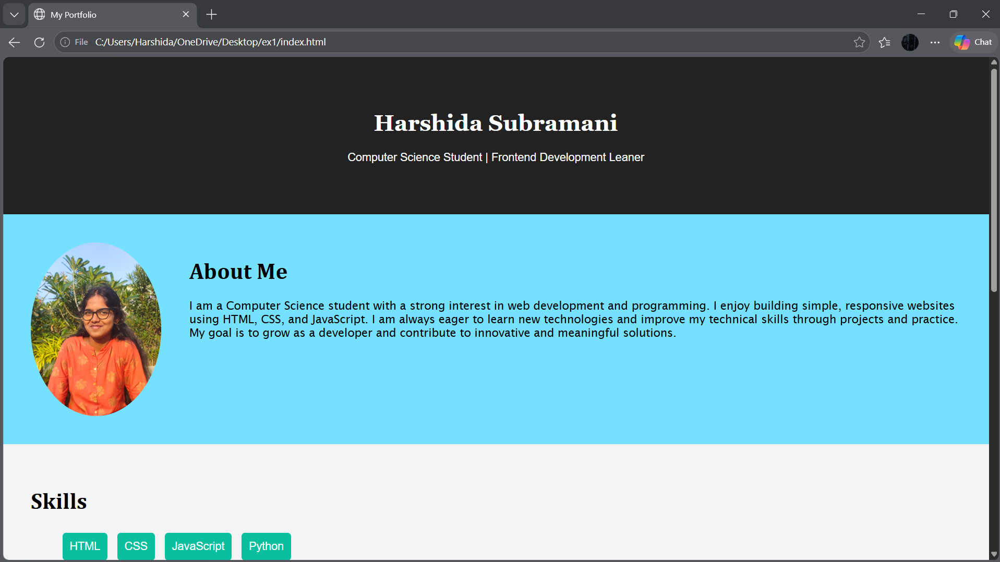
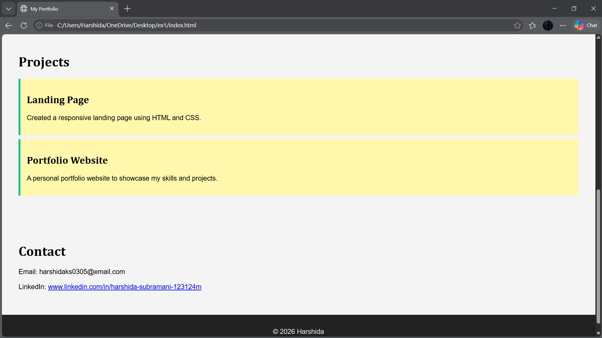

# Ex01 Portfolio
## Date: 28.10.2026

## AIM
To create a Portfolio using HTML and CSS.

## ALGORITHM
### STEP 1
Create an HTML file (index.html)

### STEP 2
Create a CSS file (style.css)

### STEP 3
Include a navigation bar with links to different sections.

### STEP 4
Add structured sections for introduction, about, projects, and contact details.

### STEP 5
Define global styles for fonts, colors, and layout.

### STEP 6
Style the header, navigation bar, and sections.

### STEP 7
Use Flexbox or CSS Grid for layout design.

### STEP 8
Add hover effects and transitions for interactivity.

### STEP 9
Add Images and Media.

### STEP 10
Use optimized images for a professional look.

### STEP 11
Open the HTML file in a browser to check layout and functionality.

### STEP 12
Fix styling issues and refine content placement.

### STEP 13
Deploy the Portfolio.

### STEP 14
Upload to GitHub Pages for free hosting.

## PROGRAM

index.html
```
<!DOCTYPE html>
<html lang="en">
<head>
    <title>My Portfolio</title>
    <link rel="stylesheet" href="style.css">
</head>

<body>

<header>
    <h1 style="font-family: Georgia, 'Times New Roman', Times, serif;">Harshida Subramani</h1>
    <p>Computer Science Student | Frontend Development Leaner</p>
</header>

<section class="about">
    
    <div>
        <h1 style="font-family: Cambria, Cochin, Georgia, Times, 'Times New Roman', serif;">About Me</h1>
        <p>
            <p style="font-family: 'Lucida Sans', 'Lucida Sans Regular', 'Lucida Grande', 'Lucida Sans Unicode', Geneva, Verdana, sans-serif;">
                I am a Computer Science student with a strong interest in web development and programming. 
                I enjoy building simple, responsive websites using HTML, CSS, and JavaScript. 
                I am always eager to learn new technologies and improve my technical skills through projects and practice. 
                My goal is to grow as a developer and contribute to innovative and meaningful solutions.
        </p>
    </div>
</section>

<section class="skills">
    <h1 style="font-family: Cambria, Cochin, Georgia, Times, 'Times New Roman', serif;">Skills</h1>
    <ul>
        <li>HTML</li>
        <li>CSS</li>
        <li>JavaScript</li>
        <li>Python</li>
    </ul>
</section>

<section class="projects">
    <h1 style="font-family: Cambria, Cochin, Georgia, Times, 'Times New Roman', serif;">Projects</h1>

    <div class="project">
        <h2 style="font-family: Cambria, Cochin, Georgia, Times, 'Times New Roman', serif;">Landing Page</h2>
        <p>Created a responsive landing page using HTML and CSS.</p>
    </div>

    <div class="project">
        <h2 style="font-family: Cambria, Cochin, Georgia, Times, 'Times New Roman', serif;">Portfolio Website</h2>
        <p>A personal portfolio website to showcase my skills and projects.</p>
    </div>
</section>

<section class="contact">
    <h1 style="font-family: Cambria, Cochin, Georgia, Times, 'Times New Roman', serif;">Contact</h1>
    <p>Email: harshidaks0305@email.com</p>
    <p>
        LinkedIn: 
        <a href="https://www.linkedin.com/in/harshida-subramani-123124m" target="_blank">
            www.linkedin.com/in/harshida-subramani-123124m
        </a>
    </p>
</section>

<footer>
    <p>© 2026 Harshida</p>
</footer>

</body>
</html>
```

style.css
```
body{
    font-family: Arial;
    margin:0;
    background:#f4f4f4;
}

header{
    background:#222;
    color:rgb(255, 255, 255);
    text-align:center;
    padding:55px;
}

.about{
    display:flex;
    padding:40px;
    background:rgb(118, 225, 255);
}

.about img{
    width:185px;
    margin-right:40px;
    border-radius:50%;
}

.skills, .projects, .contact{
    padding:40px;
}

.skills ul{
    list-style:none;
}

.skills li{
    background:#0abf9e;
    color:white;
    display:inline-block;
    padding:10px;
    margin:5px;
    border-radius:5px;
}

.project{
    background:rgb(255, 247, 172);
    padding:15px;
    margin:10px 0;
    border-left:5px solid #0abf9e;
}

footer{
    background:#222;
    color:rgba(255, 255, 255, 0.793);
    text-align:center;
    padding:15px;
}
```

## OUTPUT




## RESULT
The program for creating Portfolio using HTML and CSS is executed successfully.
